 

I started my first business at 13, moved from Tehran to Toronto at 14, and taught myself to code on a laptop with a broken screen. I shovelled driveways to fund my first clothing run, graduated high school six months early to build full-time, and I'm now co-founding **[Rumy](https://rumyapp.com)** while studying business at **Schulich**.

 

 

 

  

 

 

  
  &nbsp;
  

